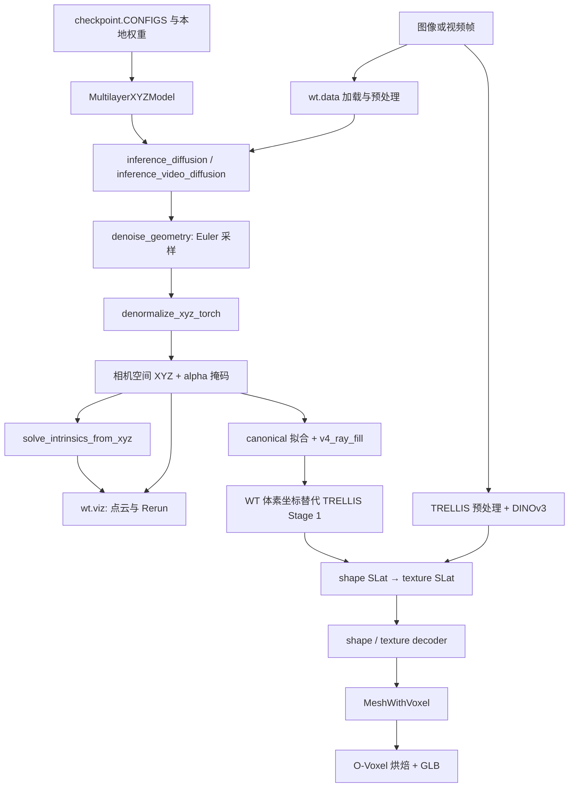

# 推理代码结构与几何约定

本文件维护当前实现的调用关系和数据契约，覆盖 WT 原生输出与 TRELLIS.2 hybrid。使用方法见 [README](../README.md)，实验命令、检查结果见 [RUNBOOK](../RUNBOOK.md)，未完成项见 [PROGRESS](../PROGRESS.md)。第三方实现以 [dependencies.lock](../dependencies.lock) 的提交为准；修改接口、坐标或归一化时同步更新本文与对应测试。

## 1. 总览：两条输出路径



`wt` 是推理包，不包含训练入口。发布配置的 `depth_only=True` 表示只扩散几何、不扩散 mask；结合 `output_mode='xyz'`，它仍预测 **XYZ 三通道**，不是单通道深度。

## 2. WT 原生输出：按执行顺序

### 2.1 初始化和预处理

| 顺序 | class / function | 输入 → 输出 / 职责 |
| --- | --- | --- |
| 1 | `examples/infer_rgba.main` / `infer_scene.main` / `infer_video.main` | 解析配置、路径与种子；不指定种子默认运行 42–45 |
| 2 | `wt.checkpoint.build_model_and_load_ckpt` | `CONFIGS[name]` → `MultilayerXYZModel(**model_kwargs)` → 权重加载 → `eval()` |
| 3 | `resolve_ckpt_path` → `download_from_hf`（按需）→ `load_checkpoint` | 配置简称 / HF URI / 本地 `.pt` → state dict；有 EMA 时优先 EMA |
| 4 | `wt.data.load_rgba_image` 或 `load_video_clip` | 文件 → uint8 RGBA；已有 alpha 直接使用，否则按入口决定是否抠图 |
| 5 | `compute_object_crop` / `compute_clip_shared_crop` → `crop_with_padding` | 物体使用 alpha 包围框，默认最长边占裁剪画布的 2/3；视频所有帧共享同一个裁剪窗口 |
| 6 | `preprocess_rgba_for_model` / `preprocess_clip_for_model` | 裁剪、背景处理、缩放、mask 腐蚀、复制到几何层，返回 RGB、mask、K |

源码：[checkpoint.py](../wt/checkpoint.py)、[data.py](../wt/data.py)、[cli.py](../wt/cli.py)。

| 发布配置 | 原生入口 | RGB / mask 形状（B 通常为 1，L=6） | 输出尺度 |
| --- | --- | --- | --- |
| `r75b` | `infer_rgba.py` | `[B,3,504,504]` / `[B,L,504,504]` | `zscore` 逆变换后的训练度量尺度；不保证真实物体尺寸准确 |
| `r69l` | `infer_scene.py` | `[B,3,840,840]` / `[B,L,840,840]` | `median_log_global` 的相对尺度，未知原始尺度未恢复 |
| `r76` | `infer_video.py` | `[B,T,3,336,336]` / `[B,T,L,336,336]`，T=16 | 与 r75b 相同的 z-score 逆变换 |

场景入口默认不抠图、不做物体裁剪、保留 RGB。物体/视频入口有各自的前景处理，不应仅替换 `--config` 就认为数据语义相同。`r76` 应从视频入口运行；单图入口不能处理它的时间噪声参数。

单图 RGB 在缩放前按软 alpha 合成：`RGB * alpha + background * (1-alpha)`；mask 另按 `alpha > 127` 构造。视频实现则在缩放、mask 腐蚀后对无效区域填背景，**不是同一套软 alpha 合成**。这属于当前上游行为，不能为统一形式随意改动训练输入分布。

### 2.2 扩散采样到模型内部

```text
inference_diffusion(model, rgb, gt_mask, **cfg["inference_kwargs"])
  ├─ RGB 复制到 L 层；建立 conditioning 与随机 XYZ 噪声
  └─ denoise_geometry(model, x_t, conditioning, iterations=20)
       └─ 每一步调用 MultilayerXYZModel.forward(psi_t, t, conditioning)
            ├─ net.encode_image → encode_image_moge：冻结的图像编码器
            ├─ 复制图像 tokens 到各几何层，添加 layer embedding / FiLM
            └─ net(...)：MultilayerBackbonePatched
                 └─ 继承 MultilayerBackbone.forward 的 diffusion 分派
                      └─ MultilayerBackbonePatched._forward_denoising
                           ├─ encode_conditioning / 几何噪声投影
                           ├─ decode_to_output_tokens：frame / ray / global attention
                           └─ SplitTransformerProjection.forward_geo_only
                                └─ unpatchify → {"v_t": [B,L*H*W,3]}
```

源码：[inference.py](../wt/inference.py)、[sampling.py](../wt/sampling.py)、[model.py](../wt/model.py)、[backbone.py](../wt/_core/arch/models/backbone.py)。`MultilayerBackbonePatched` 和 `SplitTransformerProjection` 都定义在 `wt/model.py`，不能仅按文件名把它当成轻量 wrapper。

`denoise_geometry` 将噪声 `[B,3,L,H,W]` 展开为 tokens。按 `t:1→0` 执行 `x_next = x - (t-t_next) * v_t`，再还原 `[B,L,H,W,3]`。这是像素空间几何扩散，没有 WT 几何 VAE。发布配置关闭 AR 和额外 cross-attention；不能把文件中所有实验分支都视为当前运行路径。默认调用不会跨 Euler 步缓存图像 tokens。

视频由 `inference_video_diffusion` 将 `T*L` 合并成内部层轴，并通过 `conditioning['num_time']` 通知模型。图像编码按每帧一次展开到 L 层，`TemporalAttentionBlock` 负责时间交互；`time_correlated_noise` 使用 `rho=0.5` 构造跨帧相关噪声。最后恢复 `[B,T,L,H,W,3]`。

`inference_diffusion_multiview` 是另一条兼容多视图 checkpoint 的 API：把 `[B,V,...]` 合并成 `[B*V,...]`，返回 `[B,V,L,H,W,3]`。当前 r69l 场景示例调用的是单图函数；增加 V 维不会自动估计外参、融合到共同世界坐标，也不代表发布权重已完成多视图验收。

### 2.3 反归一化、相机拟合与可视化

1. `inference_*` 使用输入 mask，保持后层 mask 不超出前层；取预测前三通道，经 `denormalize_xyz_torch` 还原尺度，无效位置置零。
2. r75b/r76：`XYZ = prediction * XYZ_STD + XYZ_MEAN`。这是逐通道统计逆变换，**不同于 hybrid 的等比缩放**。
3. r69l：`x,y = sign(t)*(exp(abs(t))-1)`，`z = exp(t_z)`。未知训练样本中值尺度不可凭空恢复，函数在相对尺度框架下输出。
4. 原生返回 `(xyz_pred, mask_pred, rgb_pred)`；发布配置 `predict_color=False`，所以第三项为 `None`。XYZ 模式不会用 K 重建 X/Y，也不会强制各层沿同一针孔射线或深度单调。
5. `solve_intrinsics_from_xyz` 用第 0 层有限、正深度点拟合 `u=fx*X/Z+cx`、`v=fy*Y/Z+cy`。失败返回 `None`，示例使用预处理的默认 K；拟合 K 只是投影近似，不修正预测点，不恢复尺度。
6. `wt.viz.init_recording*` → `log_prediction*` / `log_video_*` → `save_rrd`。相机约定为 `rr.ViewCoordinates.RDF`；前层使用输入 RGB，后层通常用深度灰度。多种子显示会沿 X 轴加展示偏移，每层还有显示点数上限；`.rrd` 不能当成无损的原始预测张量。

原生示例主要持久化 `.rrd`，没有默认导出完整 XYZ 的 `.npz`。需要计算或测量时应直接使用函数返回值，而不是从可视化中读取已经抽样、偏移的点云。

## 3. TRELLIS.2 hybrid：按执行顺序

主入口：[examples/infer_textured_mesh.py](../examples/infer_textured_mesh.py)。初始化阶段会先建立 WT 模型和 TRELLIS pipeline，再进入种子循环；每个种子先运行 WT，随后将 WT 模型移到 CPU，最后执行以下流程。

| 顺序 | class / function | 数据和职责 |
| --- | --- | --- |
| 1 | `load_trellis2_pipeline` → 内部 `HybridPipeline.from_pretrained` | 默认优先本地 descriptor；只加载该模式的 shape/texture flow 和 decoder，排除 Stage-1 flow/decoder |
| 2 | `aggregate_camera_cloud` | `[L,H,W,3]` + mask → 全部有限前景点 `[N,3]`；尺度拟合不抽样 |
| 3 | `compute_canonical_transform` → `CanonicalTransform` | 轴变换、中心平移、等比缩放，拟合到 `[-0.45,0.45]^3` |
| 4 | `v4_ray_fill` → `expand_cloud_ray_xyz` | 相邻有效层之间线性插入 3D 点，再 `tf.apply`、量化、闭运算、孔洞填充，得到 `[M,3]` int32 |
| 5 | `inject_coords_into_trellis2` | 验证网格范围、唯一性及单批次；添加 batch=0 列，得到 `[M,4]` 的 `[batch,x,y,z]` |
| 6 | `Trellis2ImageTo3DPipeline.preprocess_image` → `get_cond` → `DinoV3FeatureExtractor` | 使用原始 RGBA 独立构造 TRELLIS 条件；必要时 RMBG，裁剪、黑底合成、512/1024 特征提取 |
| 7 | `sample_shape_slat` 或 `sample_shape_slat_cascade` | `SparseTensor(coords, Gaussian feats)` → `FlowEulerGuidanceIntervalSampler.sample` → `SLatFlowModel.forward` → shape SLat |
| 8 | `sample_tex_slat` | 将 shape SLat 重新标准化作为 `concat_cond`，采样 texture SLat；不是 WT 的输入 RGB 直接投影纹理 |
| 9 | `decode_latent` → `decode_shape_slat` | `FlexiDualGridVaeDecoder` / `SparseUnetVaeDecoder` → `flexible_dual_grid_to_mesh`，得到 canonical mesh 及稀疏层级 `subs` |
| 10 | `decode_tex_slat(slat, guide_subs=subs)` | 在形状解码层级上解码 PBR 体素属性；组成 `MeshWithVoxel`，含 vertices/faces/coords/attrs/layout/voxel_size |
| 11 | `save_mesh_glb` → `o_voxel.postprocess.to_glb` → `Trimesh.export` | 清理/重网格化/简化、UV 展开与纹理烘焙，canonical Z-up 转 glTF Y-up，写 GLB |
| 12 | 示例写同名 JSON | 保存 `canonical_transform`、轴矩阵、种子、采样/网格参数；`decoded_vertices/faces` 是简化前统计 |

本地桥接源码：[canon.py](../wt/textured_mesh/canon.py)、[voxelise.py](../wt/textured_mesh/voxelise.py)、[pipeline.py](../wt/textured_mesh/pipeline.py)。第三方调用入口：[trellis2_image_to_3d.py](../dependencies/TRELLIS.2/trellis2/pipelines/trellis2_image_to_3d.py)、[structured_latent_flow.py](../dependencies/TRELLIS.2/trellis2/models/structured_latent_flow.py)、[fdg_vae.py](../dependencies/TRELLIS.2/trellis2/models/sc_vaes/fdg_vae.py)、[O-Voxel postprocess.py](../dependencies/TRELLIS.2/o-voxel/o_voxel/postprocess.py)。这些相对链接要求先克隆锁定依赖。

这里以具体函数名区分 shape、texture、decode，避免不同论文/仓库对“Stage 2/3”的编号差异。实际跳过的是 `sample_sparse_structure`；WT 提供几何占据结构，后续网络仍会修改表面，坐标可逆不代表生成几何与 WT 点逐点一致。

### 模式、网格和 cascade

| `pipeline_type` | 注入网格 R | shape 模型 / 条件 | texture 模型 | mesh 解码分辨率 D |
| --- | --- | --- | --- | --- |
| `512` | 32 | 512 | 512 | 512 |
| `1024` | 64 | 1024 | 1024 | 1024 |
| `1024_cascade` | 32 | 512 → 上采样 → 1024 | 1024 | 1024 |
| `1536_cascade` | 32 | 512 → 上采样 → 1024 模型 | 1024 | 最多 1536，可按 token 数降低到 1024 |

R 是 flow 输入的稀疏位置网格，D 是最终形状/纹理网格，不能混用。cascade 先从 R=32 的 shape SLat 经 `shape_slat_decoder.upsample(..., upsample_times=4)` 得到 512 网格坐标 q，再执行：

```text
high_latent_index = floor((q + 0.5) / 512 * (D // 16))
```

随后去重、运行高分辨率 flow。解码使用 cascade **实际返回的 D**，不是简单读取模式名。`max_num_tokens` 控制分辨率回退，达到 D=1024 就停止降低，因此不是硬显存上限。`max_voxels` 则在 WT 体素化后随机删点，会改变占据结构，不等价于降低分辨率。

shape/texture 的 `*_slat_normalization` 是神经 latent 通道的均值/方差，与几何单位、相机尺度无关。`MeshWithVoxel.voxel_size=1/D` 属于 canonical 单位；它不是原始相机单位下的体素尺寸。

## 4. 坐标、尺度与投影契约

### 4.1 相机 → canonical → GLB

以下数学使用列向量；NumPy 点数组为行向量，右乘矩阵转置。

```text
p_camera = (x right, y down, z forward)
R = [[1,0,0], [0,0,1], [0,-1,0]]
R @ p_camera = (x, z, -y)                # canonical Z-up
c = mean(R @ p_camera)                  # 在旋转后的 WT 单位中
s = 0.45 / max(abs(R @ p_camera - c))   # 单一正标量；实现对零范围做 epsilon 保护
p_canonical = s * (R @ p_camera - c)

G = [[1,0,0], [0,0,1], [0,-1,0]]
p_glb = G @ p_canonical                 # glTF Y-up: (x, z, -y)
p_camera = R.T @ (G.T @ p_glb / s + c)
```

R 与 G 数值相同，但作用于不同阶段，不能只做一次或在加载 GLB 时再次做正向旋转。两者行列式均为 +1，保持右手系和三角面绕序。默认映射下物体朝向相机的一面位于 canonical 的负 Y 一侧；不能把“Z-up”误当成原始拍摄相机的姿态。

`centroid` 不是原始相机坐标中的中心，而是 **R 作用后、s 作用前** 的中心。GLB 不保留 WT 原尺度；r75b/r76 可通过保存的变换回到其预测度量尺度，r69l 仍只能回到其预测相对尺度。`y_flip` 兼容选项是反射（det=-1），不是默认旋转；若用于网格，还需另外处理绕序/法线。

恢复导出网格的点坐标：

```python
import json
from pathlib import Path
import trimesh
from wt.textured_mesh import CanonicalTransform, glb_to_camera

path = Path("/mnt/oss1/lemonade_factory/SYNC/shuqiliu/output/world_tracing/experiments/20261013-P0-gso-pilot-v1/samples/SCHOOL_BUS/wt_trellis2/defaults-v1/seed-0042/mesh.glb")
meta = json.loads(path.with_suffix(".json").read_text())
tf = CanonicalTransform(**meta["canonical_transform"])
scene = trimesh.load(path, force="scene", process=False)
mesh = scene.to_geometry()  # 先应用 GLB scene-node 变换
camera_vertices = glb_to_camera(mesh.vertices, tf)
```

这里仅恢复顶点坐标；若重新导出相机坐标网格，还要正确旋转法线。简化、重网格化与神经解码带来的几何改变不可用逆变换消除。不要从示例中省略 JSON：仅有 GLB 无法恢复中心和尺度。

### 4.2 体素量化

`v4_ray_fill` 对每个 canonical 分量执行 `i=floor((p+0.5)*R)`，网格轴顺序始终是 **x,y,z**，没有 ZYX 交换。体素中心对应 `p_center=(i+0.5)/R-0.5`；在不做形态学的单纯量化中，每轴误差最多 `0.5/R` canonical 单位，即 WT 单位中的 `0.5/(R*s)`。

默认用全部有限前景点拟合 c/s，确保极值也落入目标盒内；相邻层间插值在端点凸包内。若先抽样再拟合，再把未抽样点体素化，极值可能落到盒外并被丢弃。闭运算/填洞会增加或删除占据单元，不能将上述量化误差当作整个 hybrid 的几何误差上界。

### 4.3 像素中心、裁剪与 K

图像左上边界为 `(0,0)`，像素中心为 `(column+0.5,row+0.5)`。`solve_intrinsics_from_xyz` 与 `_depth_to_xyz` 使用相同约定。对于原图 K、裁剪左上角 `(x1,y1)`、裁剪大小 `(Wc,Hc)`、目标边长 S：

相机轴的 OpenCV/RDF 约定不等于像素原点约定。若外部标定把第一个像素中心定义为 `(0,0)`，须先将 cx/cy 各加 0.5，再传入这里的 K。拟合与深度反投影 helper 使用零 skew 的针孔模型。

```text
A = [[S/Wc, 0, -(S/Wc)*x1],
     [0, S/Hc, -(S/Hc)*y1],
     [0, 0, 1]]
K_model = A @ K_original
```

padding 对应负的 x1/y1，同样代入公式。外部 `intrinsics_override` 表示原图内参，必须先扣裁剪原点再缩放；视频将同一个 K 和共享裁剪用于全部帧。没有提供 K 时，默认函数是在裁剪后的画布上构造训练风格的近似 K，它不是自动恢复的真实原相机标定。

WT 原生 XYZ 属于模型输入所对应的相机框架；输入经过裁剪后，不能直接把拟合 K 当成未裁剪原图的 K。TRELLIS 对图像另做更紧的前景裁剪以提取 DINO 条件；该图像裁剪不再改变已生成的 WT XYZ，也不提供新的测量外参。

## 5. 工作区改动的职责与维护边界

| 改动组 | 负责的行为 | 复查结论 / 限制 |
| --- | --- | --- |
| `wt.paths`、`wt.__init__`、CLI 默认输出、`save_rrd` | `/data1` 路径、缓存环境变量及输出目录 | 不更改几何；显式环境变量/`--out` 优先，原始数据目录不自动写入 |
| 环境声明、锁定文件、`scripts/setup_*` | 项目 Conda / CUDA 扩展与可复现安装 | 本机路径与 CUDA 架构有机器约束；不能把包快照当成跨平台安装配方 |
| 权重下载与 `prepare_trellis2_local` | 获取/核验文件并生成本地 descriptor | `--inspect` 不改写已下载权重清单；`HF_TOKEN` 来自环境，镜像不接收鉴权；descriptor 内绝对路径搬迁后需重建 |
| `wt.data`、`wt.intrinsics`、`_depth_to_xyz` | 图像裁剪标定、投影/反投影 | 原 K 裁剪偏移、像素中心一致性和有限值过滤由几何回归覆盖；XYZ 发布模型不走 depth 分支 |
| `wt.textured_mesh` 与纹理网格 CLI | 坐标轴、相似变换、体素注入和 GLB | 默认轴方向正确；全点云拟合、JSON 重载、合法尺度和导出轴转换有显式测试 |
| README / 本文 / RUNBOOK / PROGRESS | 用法 / 结构契约 / 实验记录 / 状态 | README 不保存实验流水；本文描述当前行为，测试结果与缺失项不重复堆入本文 |

审查中保留的上游限制：`load_checkpoint` 仍使用 `strict=False` 并跳过尺寸不匹配的键，不能仅凭脚本退出 0 判定任意 WT 权重完全匹配；应检查加载日志。当前已有物体权重验证未报告 missing/mismatch。各相机输入不保证精确针孔一致性，且单图没有真实外参/尺寸的监督校验；本次复查证明的是代码契约与数值路径，不是论文质量或物理测量精度。

## 6. 修改后的最小验证入口

在项目专用 screen、激活环境并 `source scripts/env.sh` 后：

```bash
PYTHONDONTWRITEBYTECODE=1 python -m pytest tests -q -p no:cacheprovider
CUDA_VISIBLE_DEVICES=0 HF_HUB_OFFLINE=1 python scripts/smoke_hybrid.py
```

[tests/test_geometry_conventions.py](../tests/test_geometry_conventions.py) 用已知相机投影、基向量、尺度变换和体素中心检查数学含义；[tests/test_hybrid.py](../tests/test_hybrid.py) 检查分支路由、坐标输入和 sampler 参数；[tests/test_paths.py](../tests/test_paths.py) 检查存储边界。随机 flow 检查不运行 mesh decoder。真实权重 GLB 的运行与复核范围以 RUNBOOK/PROGRESS 为准。

## 7. 批量推理与多结果查看

`examples/infer_batch.main` → `wt.batch.resolve_configs` → `run_batch`，输出遵循 `wt.experiment` 的 schema v1。`InferenceBackend.load_wt` 在全部 WT 作业前执行一次；`predict_wt` 为输入内容、WT 预处理/步数与 seed 的组合缓存 NPZ/RGBA。WT 阶段完成后释放模型，再用一次 `load_trellis` 加载后续任务所需模型并集。

原生分支调用 `pipeline.run`，hybrid 从 WT 缓存执行 `compute_canonical_transform` → `v4_ray_fill` → `inject_coords_into_trellis2`。`include_stage1=True` 只用于队列包含原生 TRELLIS 的情况，单图 hybrid 加载器默认仍跳过 Stage 1。TRELLIS low-VRAM 控制 CPU/GPU 搬运，不等于从磁盘重新加载 checkpoint。

调度时原生 `trellis2` 必须显式传 `parent=None`，即使其默认参数碰巧命中 hybrid 的 WT 缓存；`generate_mesh` 另行检查方法与 parent 是否一致。评价入口拒绝带 `wt_parent.json` 的原生结果，避免只凭方法目录名误归类。

`run.json` 原子标记各个输出的状态/产物；`config.json` 和输入摘要用于防止续跑覆盖不一致配置。`wt_parent.json` 指向 hybrid 实际使用的缓存；相同 seed 但预处理不同的 WT 结果不会混用。

每个样本在 `predict_wt` / `generate_mesh` 入口调用 `InferenceBackend.reset_seed`，同时固定 Python、NumPy、Torch/CUDA 随机流；TRELLIS 的各 sampler 顺序使用 pipeline 随机流。`provenance.environment` 记录硬件、版本、TF32/cuDNN 与确定性开关。正式批次从独立源码/输入快照运行，完整配置与权重清单保存在实验的 `reproduction/`。

数据准备 `examples.prepare_gso_inventory.prepare` → 原始 OBJ/纹理完整性检查 → `split_ids`，在任何预测之前冻结 asset ID 清单；`asset_seed` 按用途和资产派生随机种子。`examples.export_experiments.export` 读取小型 run/config/runtime JSON 重建工作簿，数值指标只读取真实 `metrics.json`，缺失不填 0；它不执行模型或评价。

GSO 原始数据入口为 `download_gso_mirror.download` → `verify_gso_raw.verify`：按原 ZIP 的 1030 个 ID 下载固定 revision 的原始 ZIP，核对 SHA-256，原样解压并核对成员 CRC/必要文件，最终写 `raw/gso/COMPLETE.json`。`require_complete` 是 GSO 入库、渲染和评价 CLI 的前置检查；用户已要求完整原始数据到齐后再推进实验。`import_gso_mirror.import_assets` 在输出目录创建材质路径兼容副本并与可读原 ZIP 比对，再调用 `build_inventory` / `split_ids`；不修改 raw 原件。

`prepare_gso_views.prepare` → `normalize_parts`（GT 资产空间 AABB 对角线归一为 1，源 Z-up）→ `make_camera`（RDF，FoV 40°，俯仰 20°，独立 asset view seed）→ `Rasterizer.render`（透明背景、原纹理、线性 Z）→ `compute_object_crop`（与 WT 共用裁剪）→ 更新 K 后重新渲染 504² GT。保留完整 GT mesh、相机变换及独立 GT 配准/评价采样。像素中心为 `+0.5`，不将 WT 默认内参误当渲染标定。

`evaluate_gso.evaluate_run`：WT 全层有限去重点 / 导出前 decoder mesh → 独立预测点采样 → `register_sim3`（24 个 det=+1 初始旋转、正尺度、双向最近邻）→ `chamfer`。相机分表中 hybrid 直接 `canon_inverse` 还原 decoder mesh；只有 GLB 才需要额外逆轴旋转。WT 第 0 层 Z / hybrid 已知 K 的 z-buffer → `depth_metrics`（正尺度 SSI、95% 覆盖门槛）；原生 TRELLIS 相机/深度列为 N/A。`evaluation.records.summarize` 按资产聚合，保留失败/待处理/N/A 分母，并单列默认三方法共同成功集合。

`evaluate` → 独立子进程中的 `evaluate_one` → `evaluate_run`，每个 run 结束后退出该进程，CUDA 错误不会传播到后续样本；`--workers` 控制并发，`--methods` 可分方法重算。`Rasterizer.render` 每次最多提交 100 万个面，按相机 Z 合并各批最近表面，不简化几何；这是超大 decoder mesh 的执行策略，坐标、深度和采样协议保持一致。

`viewer.main(--experiment)` → `ExperimentViewer` → `scan_experiment` 读取小型 JSON 索引；选择样本/方法/配置/seed 时调用 `read_run_geometry` → `read_geometry`，只加载当前结果。artifact 显式声明 camera_rdf / canonical_zup / gltf_yup。hybrid 可依据自己的 `canonical_transform` 恢复 WT 框架，原生 TRELLIS 不使用该变换；所有显示最终转成 Y-up，并排布局另加居中/平移。查看器没有执行 GT 配准或指标计算。文件契约见 [实验方案](20261013_hybrid-baseline.md)。
